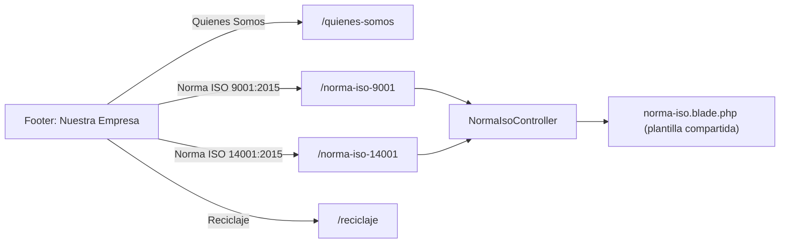

# Bitácora Diaria — 2026-11-15

> [!NOTE] Contexto de Sesión
> Se descartaron los cambios locales previos sin confirmar en `resources/views/welcome.blade.php` y se sincronizó la rama `feature/dokploy-postgres-sync` mediante fast-forward desde `7a76937` hasta `01ed213` (196 commits), conservando intacta la presentación `PAGINA KENYA MEJORA DISEÑO Y PROGRAMACION 6 14.11.2026.odp`.

## 1. Objetivo de la Solicitud del Usuario
Implementar en producción (`https://www.kenya.com.pe/`) las instrucciones de la presentación `PAGINA KENYA MEJORA DISEÑO Y PROGRAMACION 6 14.11.2026.odp` (Diseño: Fernando):
1. **Footer — Columna Nuestra Empresa:** Ocultar el enlace `Codigo Conducta` y adicionar los enlaces `Norma ISO 9001:2015` y `Norma ISO 14001:2015`.
2. **Vista Norma ISO 9001:2015:** Replicar el diseño editorial de `/codigo-conducta` con el contenido oficial de Gestión de Calidad y sus 5 pilares.
3. **Vista Norma ISO 14001:2015:** Replicar el diseño editorial de `/codigo-conducta` con el contenido oficial de Gestión Ambiental y sus 6 lineamientos.

## 2. Arquitectura y Flujo de Datos

## 3. Archivos Creados y Modificados
- **Creados:**
  - `app/Http/Controllers/NormaIsoController.php` — Catálogo backend parametrizado para ISO 9001:2015 e ISO 14001:2015 ([[Normas_ISO]]).
  - `resources/views/norma-iso.blade.php` — Plantilla Blade compartida, fiel al estándar editorial de `codigo-conducta.blade.php`.
  - `public/iso-9001.jpg` — Infografía corporativa coherente con `public/iso-37001.png`.
  - `public/iso-14001.jpg` — Infografía corporativa ambiental coherente con `public/iso-37001.png`.
- **Modificados:**
  - `routes/web.php` — Rutas `iso.9001` (`/norma-iso-9001`) e `iso.14001` (`/norma-iso-14001`).
  - `resources/views/layouts/landing.blade.php` — Ocultamiento en comentarios de `Codigo Conducta` en el footer e inclusión de enlaces a `Norma ISO 9001:2015` y `Norma ISO 14001:2015`.
  - `app/Http/Controllers/SitemapController.php` — Registro de ambas URLs en el sitemap XML.

## 4. Comandos Ejecutados y Validación
- `git restore .` y `git pull --ff-only origin feature/dokploy-postgres-sync` → fast-forward a `01ed213`.
- `php -l app\Http\Controllers\NormaIsoController.php`, `SitemapController.php`, `routes\web.php` → `No syntax errors detected`.
- Renderizado de prueba con plantilla compilada (`verify_render.php`) + verificación visual en Chrome headless para ISO 9001, ISO 14001 y Footer.

> [!SUCCESS] Decisiones Técnicas y Próximos Pasos
> - Se unificaron ambas normas en una sola vista (`norma-iso.blade.php`) y un único controlador (`NormaIsoController`) siguiendo la Ley de Tesler y evitando duplicación de CSS/HTML.
> - Se omitió el badge `Verificado` y el enlace a `IAF CertSearch` hasta contar con las URLs de acreditación oficiales de ISO 9001:2015 e ISO 14001:2015.
> - Se corrigió en la vista ISO 14001:2015 el kicker de la diapositiva 3 (que tenía `9001` copiado por error de la diapositiva 2).
> - **Próximo paso:** Cuando el usuario disponga de los certificados oficiales IAF CertSearch o imágenes finales, añadir la propiedad `verify_url` al arreglo del controlador.
